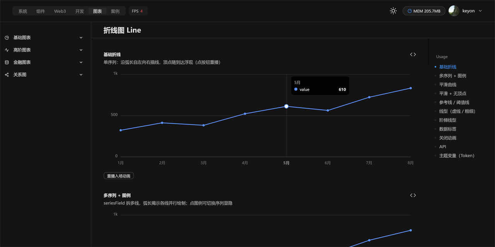
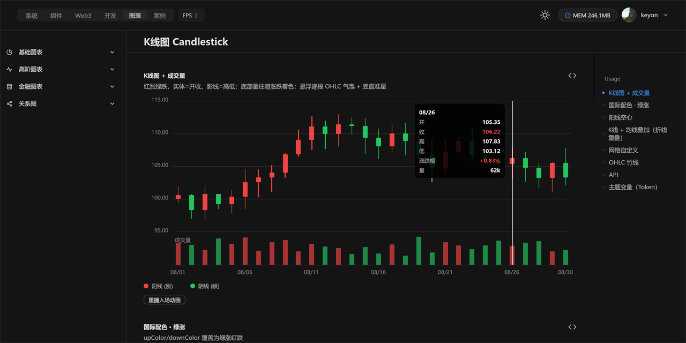
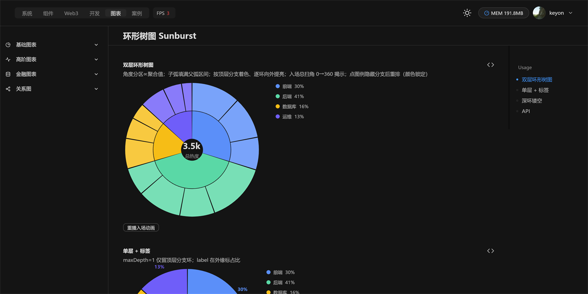

# react-native-flux-desktop-chart

> 📊 Chart component family for the pure‑React desktop rendering stack — Skia‑style self‑drawn, entry animations built in.
> 📊 纯 React 桌面渲染栈的图表组件族 —— 自绘管线、内置入场动画。

  

**Depends on / 依赖：** `react-native-flux-desktop`（UI core / UI 核心）· `react`

---



**EN** · 40+ chart types — basic, advanced, financial (candlestick / time‑sharing / indicator / depth) and relation graphs (dendrogram / indented‑tree / mind‑map / flow / org). All driven by an `@ant-design/charts`‑style data model, drawn on the native pixel pipeline with real window chrome — no Electron, no `<canvas>` DOM.

**中文** · 40+ 种图表——基础、高阶、金融（K 线 / 分时 / 指标 / 盘口深度）与关系图（生态树 / 缩进树 / 思维导图 / 流程图 / 组织架构）。数据模型对齐 `@ant-design/charts`，在原生像素管线上自绘，带真实窗口标题栏——非 Electron、非 DOM `<canvas>`。

| 折线 Line | K 线 Candlestick | 环形树图 Sunburst |
| :---: | :---: | :---: |
|  |  |  |

## Install / 安装

```bash
npm install react-native-flux-desktop        # peer：UI 核心（必需 / required）
npm install react-native-flux-desktop-chart
```

## Usage / 用法

```tsx
import { LineChart } from 'react-native-flux-desktop-chart';

const data = [
  { month: '1月', value: 320 },
  { month: '2月', value: 410 },
  { month: '3月', value: 380 },
  { month: '4月', value: 520 },
];

export default () => <LineChart data={data} xField="month" yField="value" height={280} />;
```

## Components / 组件清单

**基础图表 Basic** — `LineChart` 折线 · `AreaChart` 面积 · `ColumnChart` 柱状 · `BarChart` 条形 · `PieChart` 饼图 · `RadarChart` 雷达 · `GaugeChart` 仪表盘 · `ScatterChart` 散点 · `RoseChart` 玫瑰 · `FunnelChart` 漏斗 · `WaterfallChart` 瀑布流 · `HeatmapChart` 热力图

**高阶图表 Advanced** — `TreemapChart` 矩形树图 · `SunburstChart` 环形树图 · `SankeyChart` 桑基图 · `BoxPlotChart` 箱线图 · `HistogramChart` 直方图 · `ViolinChart` 小提琴图 · `RangeBarChart` 区间条 · `RadialBarChart` 径向条 · `BulletChart` 子弹图 · `CalendarHeatmapChart` 日历热力 · `ComboChart` 组合图 · `SparklineChart` 迷你图

**金融图表 Financial** — `CandlestickChart` K 线 · `TimeSharingChart` 分时 · `IndicatorChart` 指标 · `DepthChart` 盘口深度

**关系图 Relation** — `DendrogramChart` 生态树 · `DendrogrCompactChart` 紧凑树 · `IndentedTree` 缩进树 · `FlowChart` 流程图 · `MindMapChart` 思维导图 · `OrgChart` 组织架构

**工具 Helpers** — `movingAverage` · `sma / ema / macd / rsi / kdj / bollinger` 技术指标 · `ChartLegend` 图例 · `ReferenceLines` 参考线 · `GridLines` 网格 · `useMeasuredWidth` · `DEFAULT_PALETTE` 调色板

## Notes / 说明

- **EN** This package is a *peer* of the UI core; the core provides the renderer, theme tokens and the native window. Import chart components only from this package's root.
- **中文** 本包是 UI 核心的 *peer*：核心提供渲染器、主题 Token 与原生窗口。图表组件请仅从本包根入口导入。

## License / 许可证

MIT
